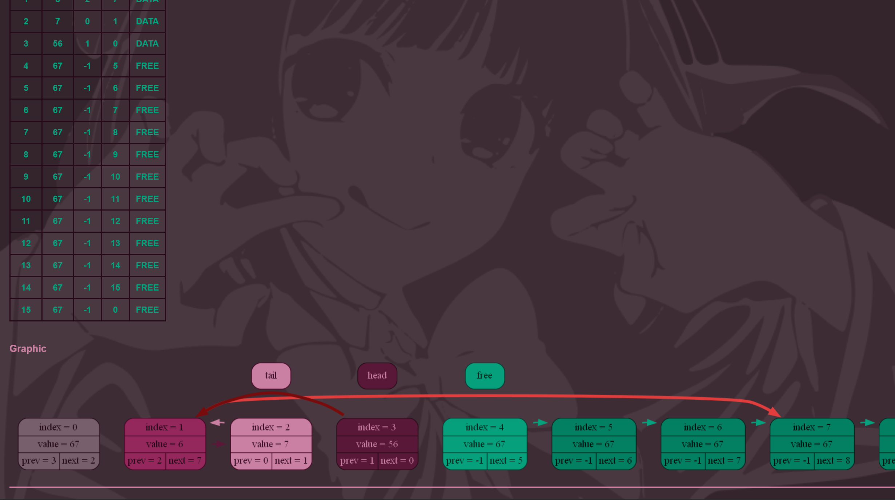

<<h2 align="center"> List </h2>

---

#### table of contents

* [overview](#overview)
* [features](#features)
* [demonstration](#demonstration)
* [option management](#usage)
* [used tools](#libraries)
* [to do](#todo)

---

#### overview

This library contains basic functions for work with doubly linked list. Among the functions designed for direct invocation by the user:
 ___ListInit___, ___ListDestroy___, ___ListAddHead___, ___ListAddTail___, ___ListAddAfterIndex___, ___ListAddBeforeIndex___, ___ListDelHead___, ___ListDelTail___, ___ListDelIndex___, ___ListVerify___, ___ListDiagnoseError___, ___ListDump___.
Functions that modify the list control error:
 ___ListAddHead___, ___ListAddTail___, ___ListAddAfterIndex___, ___ListAddBeforeIndex___, ___ListDelHead___, ___ListDelTail___, ___ListDelIndex___
 -return one of the following values characterizing the success of execution: ___SUCCESS___, ___FATAL_ERROR___, special value ___OVERFLOW___ or ___VACUUM___ depending on function. Value ___FATAL_ERROR___ is returned when ___ListVerify___ detects fatal violations in the list structure that prevent list operations. you can determine the exact error by checking the ___.error___ field of list structure after receiving a ___FATAL_ERROR___. Value ___OVERFLOW___ means that list is filled, in that case the ___ListAdd...___ operation not be performed. Value ___VACUUM___ means that list is empty, in that case the ___ListDel...___ operation not be performed. ___SUCCESS___ mean that indicates the successful execution of a list operation.

---

#### features

* All operations on the list are performed in O(const) time.
* All the contents of the list are contained in an indexed array called ___data___.
* The program have debug mode for printing reports of function verify to log file
* The program have graphical dump in html page format.

---

#### demonstration

* __graphic dump shows incorrect links__

---

#### option management

__launch__
User has to include ___List.c___ to his program on __C__ language.

__program options__
* define macro ___DEBUG___ before including to switch on debug mode.
* Set ___LIST_DUMP_FOLDER_PREFIX___, ___LIST_LOG_FILE_NAME___, ___LIST_GRAPHVIZ_FILE_NAME___, ___LIST_HTML_LOG_FILE_NAME___ to customize ___DEBUG___ output.

---

#### used tools

__libraries__
The following __C/C++__ libraries were used in the program

* __stdio.h__
for basic functions (_printf_, _fopen_, etc.)
* __stdlib.h__
for basic functions (_realloc_)
* __assert.h__
for debug (_assert_)
* __time.h__
for dump folder naming (_strftime_, etc.)
* __string.h__
foe string functions (__strncpy__)

----

#### to do

* insert function based on element number but not element index.
* functions for accessing the value of a list element

